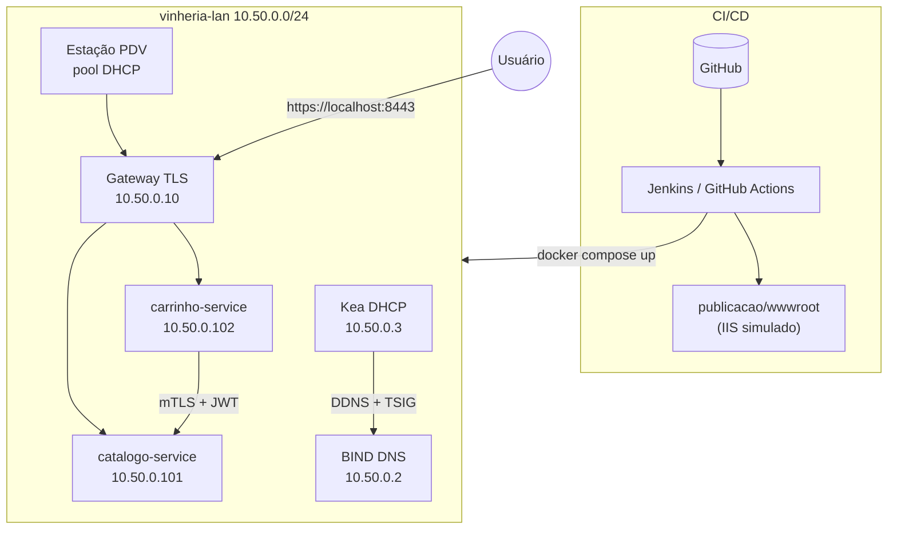

# Vinheria Agnello: Sprint 7 (Fase 7)

Simulação de parte da arquitetura da **Vinheria Agnello** com dois microsserviços
(**catalogo-service** e **carrinho-service**) rodando numa rede com **DHCP e DNS reais**,
entregues por um pipeline de **CI/CD (Jenkins + GitHub Actions)** e com **comunicação segura**
(TLS, mTLS, JWT) demonstrada com Wireshark.

| Parte da atividade | Onde está | Documentação |
|---|---|---|
| **1. Infraestrutura: rede, DHCP, DNS, 2 microsserviços** | `docker-compose.yml`, `infra/`, `services/` | [docs/01-infraestrutura-dhcp-dns.md](docs/01-infraestrutura-dhcp-dns.md) |
| **2. Pipeline de deploy com Jenkins** | `Jenkinsfile`, `jenkins/`, `scripts/` | [docs/02-pipeline-jenkins.md](docs/02-pipeline-jenkins.md) |
| **3. Comunicação segura e DevSecOps** | `services/*/app/seguranca*`, `infra/gateway/`, `scripts/demo-wireshark.sh` | [docs/03-seguranca-devsecops.md](docs/03-seguranca-devsecops.md) |
| Roteiro do PDF de entrega | — | [docs/roteiro-do-pdf.md](docs/roteiro-do-pdf.md) |

## Arquitetura



* Os serviços **recebem IP por DHCP** (reserva por MAC) e o DHCP **registra os nomes no DNS** automaticamente.
* O carrinho **descobre o catálogo pelo DNS** (registro SRV `_catalogo._tcp.vinheria.local`).
* Só o gateway é exposto ao host. Todo o tráfego interno é **HTTPS com mTLS**.

## Como rodar

Pré-requisitos: Docker Desktop (ou Docker Engine 26+ com Compose v2.24+) e um shell bash (no Windows, o **Git Bash**).

```bash
cd projetos/vinheria_agnello
cp .env.example .env
docker compose up -d --build          # sobe tudo (1ª vez: ~3 min)
bash scripts/smoke-test.sh            # 39 verificações: rede, DHCP, DNS, comunicação, segurança
```

| Para… | Comando |
|---|---|
| Ver as concessões do DHCP | `docker compose exec dhcp kea-leases` |
| Ver a zona DNS (estático + dinâmico) | `docker compose exec dns dns-registros` |
| Consultar o DNS como uma estação | `docker compose exec estacao-pdv dig catalogo.vinheria.local` |
| Ver o catálogo no navegador | `https://localhost:8443/api/catalogo/produtos` (certificado da CA interna) |
| Gerar evidências para o PDF | `bash scripts/coletar-evidencias.sh` → `evidencias/<data>/` |
| Demonstração HTTP × HTTPS (Wireshark) | `bash scripts/demo-wireshark.sh` → `capturas/*.pcap` |
| Ataques simulados ao JWT | `docker compose exec carrinho python -m app.diagnostico` |
| Lint e segurança | `bash scripts/validar-configs.sh` · `bash scripts/scan-seguranca.sh` |
| Subir o Jenkins | `cd jenkins && cp .env.example .env && docker compose up -d --build` → `http://localhost:8090` |
| Derrubar e limpar tudo | `docker compose --profile demo-inseguro down -v` |

Credenciais de **laboratório** (troque no `.env`): operador do PDV `operador` / `Agnello@Lab2026`.

Para o host confiar no certificado do gateway, exporte a CA interna (gerada no primeiro `up`, nunca versionada):

```bash
docker compose cp estacao-pdv:/run/pki/ca.crt ./vinheria-ca.crt
curl --cacert vinheria-ca.crt https://localhost:8443/api/catalogo/produtos
# Windows (curl com Schannel): acrescente --ssl-no-revoke, pois a CA de laboratorio nao publica CRL/OCSP
```

## Estrutura

```
projetos/vinheria_agnello/
├── docker-compose.yml        # ambiente completo (rede, DHCP, DNS, serviços, gateway, PDV)
├── Jenkinsfile               # pipeline declarativo
├── infra/
│   ├── dhcp/                 # Kea DHCPv4 + D2 (DDNS): escopo, reservas, opções
│   ├── dhcp-client/          # agente DHCP (sidecar dos serviços e estação PDV)
│   ├── dns/                  # BIND 9: zonas direta/reversa, SRV, TSIG
│   ├── gateway/              # Nginx TLS (seguro) + variante HTTP (demo)
│   ├── pki/                  # bootstrap: CA interna, certificados, chaves JWT, TSIG
│   └── captura/              # tcpdump para a demo do Wireshark
├── services/
│   ├── catalogo-service/     # FastAPI: vinhos, estoque, validação de JWT
│   └── carrinho-service/     # FastAPI: carrinho, Basic auth, descoberta SRV, emissão de JWT
├── jenkins/                  # Jenkins LTS + plugins + Configuration as Code
├── scripts/                  # smoke test, evidências, demo, lint, scan, empacotar, publicar
└── docs/                     # documentação de cada parte + roteiro do PDF
```

CI no GitHub: [`.github/workflows/vinheria-agnello.yml`](../../.github/workflows/vinheria-agnello.yml)
(testes, lint, DevSecOps, ambiente completo com smoke test e evidências, publicação).
