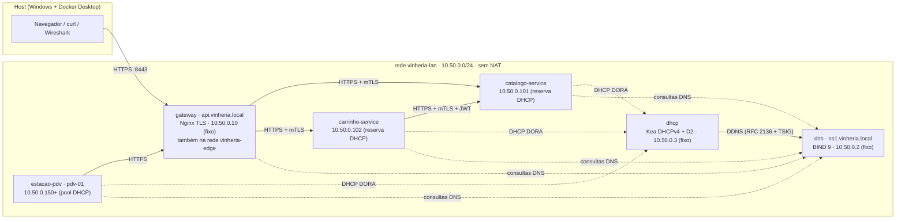
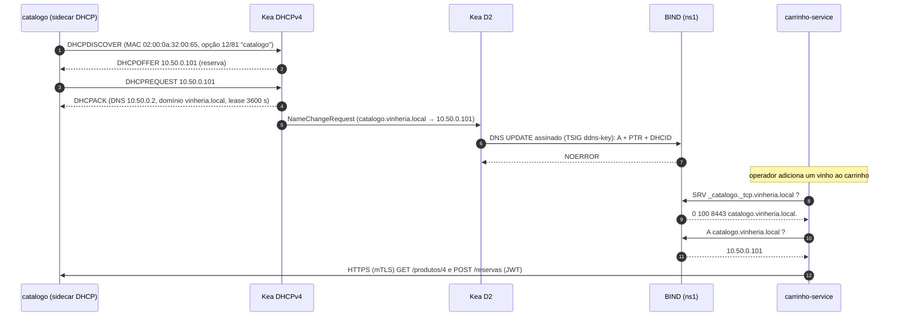

# Parte 1 — Infraestrutura e Serviços Essenciais (DHCP + DNS)

> Objetivo da atividade: *escolher 2 microsserviços do projeto anterior, criar uma estrutura
> básica de rede e serviços (Windows Server ou containers) e simular um ambiente com DHCP e
> DNS, onde os serviços são registrados e comunicam-se entre si.*

Esta parte foi implementada em **containers Docker**, mas com os **mesmos protocolos e o mesmo
comportamento de um Windows Server com as funções DHCP e DNS**: escopo, reservas, opções de
escopo, zonas direta e reversa e **atualização dinâmica segura** (o DHCP registra os nomes no DNS).

---

## 1. Microsserviços escolhidos

Os dois serviços saem diretamente das telas do projeto anterior (`catalogo.jsp` e `carrinho.jsp`):

| Serviço | Responsabilidade | Origem no projeto anterior | Depende de |
|---|---|---|---|
| **catalogo-service** | Vinhos (os mesmos 6 rótulos do `catalogo.jsp`), filtros e **estoque** | `catalogo.jsp` | — |
| **carrinho-service** | Carrinho do PDV: cria carrinho, adiciona e remove itens, calcula o total | `carrinho.jsp` | catalogo-service |

Os dois serviços **conversam entre si**: ao adicionar um item, o carrinho **descobre o catálogo pelo DNS**,
consulta o produto e **reserva o estoque**. Ou seja, a comunicação entre serviços depende de verdade
do DHCP e do DNS funcionando.

## 2. Topologia



### Plano de endereçamento — `10.50.0.0/24`

| Faixa | Uso | Quem atribui |
|---|---|---|
| `10.50.0.1` | gateway da bridge Docker | Docker |
| `10.50.0.2` | `ns1.vinheria.local`: DNS (BIND) | **IP fixo** (servidor de infraestrutura) |
| `10.50.0.3` | `dhcp.vinheria.local`: DHCP (Kea) | **IP fixo** (um servidor DHCP não pode depender de DHCP) |
| `10.50.0.10` / `.11` | `gateway` / `inseguro` (demo da Parte 3) | **IP fixo** |
| `10.50.0.16 – .31` | faixa de *bootstrap* do Docker (IPAM) | Docker: removida assim que o DHCP responde |
| `10.50.0.100 – .109` | **reservas** (microsserviços) | **DHCP**, amarrado ao MAC |
| `10.50.0.150 – .199` | **pool dinâmico** (estações/PDVs da loja) | **DHCP** |

> **Por que IP fixo só na infraestrutura?** É a prática de qualquer rede corporativa: DNS, DHCP
> e gateway precisam de endereço conhecido; *clientes e aplicações* recebem configuração do DHCP.

## 3. DHCP — ISC Kea 2.6

Arquivo: [`infra/dhcp/kea-dhcp4.conf`](../infra/dhcp/kea-dhcp4.conf)

| Conceito (Windows Server DHCP) | Implementação no Kea |
|---|---|
| Escopo `10.50.0.0/24` | `subnet4` com `id: 1` |
| Intervalo de endereços | `pools: 10.50.0.150 - 10.50.0.199` |
| **Reservas** | `reservations` por `hw-address` → `catalogo` = `.101`, `carrinho` = `.102` |
| Opção 003 Roteador | `routers = 10.50.0.1` |
| Opção 006 Servidores DNS | `domain-name-servers = 10.50.0.2` |
| Opção 015 Nome de domínio | `domain-name = vinheria.local` |
| Opção 119 Lista de pesquisa | `domain-search = vinheria.local` |
| Duração da concessão | `valid-lifetime 3600` (T1 = 900 s, T2 = 1800 s) |
| "Atualizar dinamicamente registros DNS A e PTR" | `ddns-send-updates` + **Kea D2** |
| Console de concessões | `docker compose exec dhcp kea-leases` (API `lease4-get-all`) |

### Como um microsserviço recebe IP (padrão *sidecar*)

O container da aplicação roda **sem nenhum privilégio** (usuário 10001, `cap_drop: ALL`, FS somente
leitura). Quem fala DHCP é um **sidecar** (`catalogo-dhcp`), que compartilha o namespace de rede do
serviço (`network_mode: service:catalogo`) e tem só `NET_ADMIN`/`NET_RAW`:

1. O Docker cria a interface com um IP provisório (faixa `.16–.31`) e o **MAC fixo** do serviço (`02:00:0a:32:00:65`).
2. O sidecar executa `udhcpc` (cliente DHCP) enviando **opção 12 (hostname)** e **opção 81 (FQDN)**.
3. **DISCOVER → OFFER → REQUEST → ACK**: o Kea reconhece o MAC e entrega a **reserva** `10.50.0.101`.
4. O *hook* [`udhcpc-hook.sh`](../infra/dhcp-client/udhcpc-hook.sh) remove o IP provisório e aplica o IP do DHCP:
   a partir daí o host existe **apenas** com o endereço do DHCP.
5. Ao parar o container, o cliente envia **DHCPRELEASE** e o registro some do DNS.

A estação `estacao-pdv` faz o mesmo, mas sem reserva: recebe um IP do **pool** e grava o DNS
recebido por DHCP no próprio `/etc/resolv.conf`, como um computador Windows faria.

## 4. DNS — BIND 9.18 (autoritativo)

Arquivos: [`named.conf`](../infra/dns/named.conf), [`db.vinheria.local`](../infra/dns/zones/db.vinheria.local), [`db.10.50.0`](../infra/dns/zones/db.10.50.0)

| Zona | Tipo | Conteúdo estático (Git) | Conteúdo dinâmico (DHCP) |
|---|---|---|---|
| `vinheria.local` | primária, direta | `ns1`, `dhcp`, `gateway`, `api` (CNAME), **SRV** e **TXT** de serviço | **A** + **DHCID** de `catalogo`, `carrinho`, `pdv-01` |
| `0.50.10.in-addr.arpa` | primária, reversa | PTR da infraestrutura | **PTR** dos hosts DHCP |

### Registro e descoberta de serviços

* **Registro**: ninguém cadastra `catalogo.vinheria.local` à mão. Quem cria o registro A/PTR é o
  servidor DHCP, no momento da concessão, via **RFC 2136 (DNS UPDATE) assinado com TSIG HMAC-SHA256**.
* **Descoberta**: o carrinho não tem o endereço do catálogo no código. Ele consulta
  `_catalogo._tcp.vinheria.local` (**SRV**, RFC 2782), que responde `0 100 8443 catalogo.vinheria.local.`
  (*host + porta*), e depois resolve o A dinâmico. O registro TXT publica metadados (`path`, `proto`, `auth`).
* **Persistência**: as zonas ficam num volume. Reiniciar o DNS **não** apaga os registros do DHCP
  (eles vivem no *journal* `.jnl`), e o Kea ainda re-registra a cada renovação (`ddns-update-on-renew`).

### Endurecimento (hardening) do DNS

| Controle | Por quê |
|---|---|
| `recursion no` | não é *open resolver* (evita amplificação/DDoS) |
| `allow-query { 10.50.0.0/24; }` | só a LAN consulta |
| `update-policy { grant ddns-key zonesub ANY; }` | **somente quem tem a chave TSIG** registra nomes. Um `nsupdate` forjado recebe `REFUSED` (testado no smoke test) |
| `allow-transfer { 127.0.0.1; }` | AXFR só local (auditoria); nada de vazar a zona |
| `version "nao divulgado"` | não revela a versão do BIND |
| `rate-limit` | RRL contra abuso |
| chave TSIG fora do Git | gerada no primeiro `up` pelo job `pki-init` |

## 5. Fluxo completo: do boot ao primeiro pedido



## 6. Como reproduzir

```bash
cd projetos/vinheria_agnello
cp .env.example .env
docker compose up -d --build
bash scripts/smoke-test.sh          # 39 verificações automáticas
bash scripts/coletar-evidencias.sh  # gera evidencias/<data>/ com tudo para o PDF
```

### Capturas de tela sugeridas para o PDF (Parte 1)

| # | O que mostrar | Comando |
|---|---|---|
| 1 | Containers no ar e saudáveis | `docker compose ps` |
| 2 | Rede: sub-rede, faixa do Docker, NAT desligado | `docker network inspect vinheria-lan` |
| 3 | Configuração do DHCP (escopo, pool, reservas, opções) | `docker compose exec dhcp cat /etc/kea/kea-dhcp4.conf` |
| 4 | **Concessões ativas** | `docker compose exec dhcp kea-leases` |
| 5 | Cliente DHCP: DISCOVER → ACK | `docker compose logs catalogo-dhcp estacao-pdv` |
| 6 | **DDNS**: BIND recebendo atualização assinada | `docker compose logs dns \| grep update:` |
| 7 | **Zona completa** (estático + dinâmico) | `docker compose exec dns dns-registros` |
| 8 | Resolução de nomes a partir de uma estação | `docker compose exec estacao-pdv dig catalogo.vinheria.local` |
| 9 | DNS entregue por DHCP | `docker compose exec estacao-pdv cat /etc/resolv.conf` |
| 10 | **Comunicação entre os serviços** (descoberta SRV) | `curl ... /api/carrinho/diagnostico/descoberta` (ver `coletar-evidencias.sh`) |
| 11 | Smoke test verde | `bash scripts/smoke-test.sh` |

## 7. Problemas reais encontrados (e como foram resolvidos)

Bons pontos para a **reflexão final** do relatório:

1. **Rede `internal: true` do Docker quebra o DHCP.** As regras de isolamento descartam pacotes cuja
   origem/destino está fora da sub-rede, e o `DHCPDISCOVER` sai de `0.0.0.0` para `255.255.255.255`.
   O tcpdump mostrava o DISCOVER saindo do cliente e nunca chegando ao servidor. *Solução:* bridge
   comum com `enable_ip_masquerade=false` (sem NAT ⇒ sem saída para a internet).
2. **O IP do DHCP "sumia" logo depois de aplicado.** No Linux, remover o endereço **primário** de uma
   sub-rede remove junto os **secundários** (`promote_secondaries=0`). *Solução:* remover primeiro o IP
   provisório do Docker e só depois aplicar o lease.
3. **Reiniciar o DNS apagava os registros dinâmicos** (zona em tmpfs). *Solução:* zonas em volume
   persistente + re-semeadura só quando o arquivo versionado muda (hash SHA-256) + `ddns-update-on-renew`.
4. **Kea sem permissão no diretório de leases** com `cap_drop: ALL` (root sem `DAC_OVERRIDE` não grava
   em pasta de outro usuário). *Solução:* diretório pertencente ao próprio processo, definido no build.
5. **Git Bash reescrevendo caminhos** (`/etc/resolv.conf` → `C:/Program Files/Git/etc/resolv.conf`) ao
   chamar `docker exec`. *Solução:* `MSYS_NO_PATHCONV=1` em `scripts/lib.sh`.
6. **Porta 8080 já ocupada** (Airflow local). *Solução:* portas parametrizadas no `.env` (`8443`/`8880`).

## 8. Equivalência com o Windows Server

| Windows Server | Este ambiente |
|---|---|
| Função **DHCP Server** + console DHCP | Kea DHCPv4 + `kea-leases` |
| Escopo, intervalo de exclusão, reservas | `subnet4`, faixa `.16–.31` fora do pool, `reservations` |
| Função **DNS Server** + Gerenciador DNS | BIND 9 + `dns-registros` |
| Zona primária integrada / zona de pesquisa reversa | `vinheria.local` / `0.50.10.in-addr.arpa` |
| "Atualizações dinâmicas: **somente seguras**" | `update-policy` + **TSIG** |
| DHCP registrando A/PTR em nome do cliente | `ddns-override-client-update` + Kea D2 |
| Registros SRV do Active Directory (`_ldap._tcp`) | `_catalogo._tcp` / `_carrinho._tcp` |
