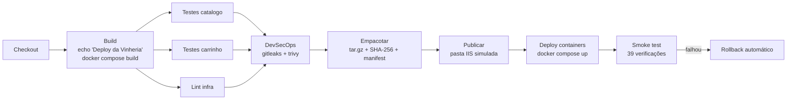

# Parte 2 — Pipeline de Deploy com Jenkins

> Objetivo: *repositório Git com o código dos serviços + pipeline no Jenkins que faça um build
> simples (`echo "Deploy da Vinheria"`) e o deploy numa pasta de publicação (simulando IIS).*

O pipeline vai bem além do mínimo. Ele é **o mesmo** em dois motores:

* **Jenkins** ([`Jenkinsfile`](../Jenkinsfile)): roda localmente num Jenkins 100% configurado por código.
* **GitHub Actions** ([`.github/workflows/vinheria-agnello.yml`](../../../.github/workflows/vinheria-agnello.yml)):
  roda a cada `push`, sem servidor próprio.

Os dois chamam **os mesmos scripts** (`scripts/*.sh`), então não existe "funciona no meu Jenkins".

## 1. Estágios



| Estágio | O que faz | Falha o build quando… |
|---|---|---|
| **Checkout** | clona o repositório e nomeia o build `#N v1.0.N (commit)` | — |
| **Build** | `echo "Deploy da Vinheria - build …"`, valida o compose e constrói as imagens. **Durante o build** o BIND roda `named-checkzone`, o Kea roda `kea-dhcp4 -t` e o Nginx roda `nginx -t` (*shift-left*) | configuração inválida |
| **Qualidade** (paralelo) | `ruff` + `pytest` **dentro** do Dockerfile multi-stage (estágio `teste`), gerando JUnit XML; `hadolint` + `shellcheck` + `compose config` | teste/lint vermelho |
| **DevSecOps** | `gitleaks` (segredos), `trivy fs` (dependências/misconfig), `trivy image` (CVEs críticas) | segredo commitado |
| **Empacotar** | `dist/vinheria-agnello-<versão>.tar.gz` + `.sha256` + `manifest.json` (versão, commit, build, imagens) | — |
| **Publicar (IIS simulado)** | confere o SHA-256, extrai em `releases/<versão>/`, troca o `wwwroot/`, registra no `deploy.log` e mantém os 5 últimos releases | checksum inválido |
| **Deploy dos containers** | `docker compose up -d` + espera os *healthchecks* | serviço não fica saudável |
| **Smoke test** | `scripts/smoke-test.sh` (DHCP, DNS, comunicação, segurança) → JUnit | qualquer verificação |
| **post / failure** | **rollback** automático da pasta de publicação | — |

## 2. Pasta de publicação (simulação do IIS)

O IIS serve uma pasta física (`C:\inetpub\wwwroot\...`). Aqui, a pasta `publicacao/` (no host) tem o
mesmo papel:

```
publicacao/
├── wwwroot/              ← o que o "IIS" serve (release ativo)
│   ├── index.html        ← página de status: versão, commit, build, data
│   ├── manifest.json
│   └── web.config        ← configuração que o IIS leria (cabeçalhos de segurança)
├── releases/
│   ├── 1.0.7/            ← releases imutáveis (os últimos 5)
│   └── 1.0.8/
├── versao-atual.txt
├── historico.txt         ← ordem dos deploys (usada no rollback)
└── deploy.log            ← auditoria: data | build | DEPLOY 1.0.7 -> 1.0.8
```

Rollback manual: rode o job com o parâmetro **ROLLBACK** marcado, ou `bash scripts/publicar.sh --rollback publicacao`.

## 3. Subindo o Jenkins (Jenkins Configuration as Code)

```bash
cd projetos/vinheria_agnello/jenkins
cp .env.example .env            # defina JENKINS_ADMIN_SENHA
docker compose up -d --build    # http://localhost:8090  (admin / senha do .env)
```

Nenhuma tela de configuração é clicada: [`casc.yaml`](../jenkins/casc.yaml) cria o usuário, a política de
segurança e o job **`vinheria-agnello`** (Job DSL), apontando para este repositório e para
`projetos/vinheria_agnello/Jenkinsfile`. O job verifica o Git a cada 2 minutos (*poll SCM*).
Também dá para clicar em **Construir com parâmetros**.

A imagem ([`jenkins/Dockerfile`](../jenkins/Dockerfile)) já traz Docker CLI + Compose + Buildx, Trivy e Gitleaks.

### Docker-out-of-Docker: decisões e cuidados

* O Jenkins usa o Docker do host pelo socket `/var/run/docker.sock`. **Quem controla o socket controla o
  host.** Isso é aceitável num laboratório; em produção o certo seria usar agentes efêmeros/isolados
  (Kubernetes, VMs) ou *rootless*.
* Por isso **nenhum serviço do compose depende de bind mount de arquivo do workspace**: as configurações do
  Nginx/BIND/Kea vão dentro das imagens (artefatos imutáveis), e os testes rodam **dentro do `docker build`**.
  O relatório JUnit sai com `--output type=local`, que é escrito pelo cliente (o Jenkins).

### Capturas de tela sugeridas (Parte 2)

1. Tela inicial do Jenkins com o job `Vinheria Agnello - CI/CD` (mensagem de sistema do JCasC).
2. **Stage View** com todos os estágios verdes.
3. *Console Output* mostrando `Deploy da Vinheria - build 1.0.N`.
4. **Test Result** (JUnit: testes unitários + smoke test).
5. Artefatos arquivados (`dist/*.tar.gz`, `.sha256`).
6. Explorer do Windows em `projetos/vinheria_agnello/publicacao/wwwroot` + `index.html` aberto no navegador.
7. `deploy.log` mostrando um DEPLOY e um ROLLBACK.
8. GitHub → aba **Actions** com o workflow verde (bônus).
